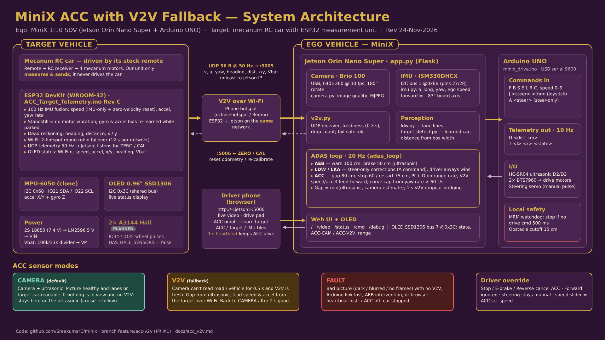

# Hackathon

## MiniX V2V ACC Demo

[▶ Watch the demo video](demo/MiniX_V2V_ACC_Demo.mp4) (1 min 56 s, 1080p, with narration)

1:10-scale software-defined vehicle demonstrator showing Vehicle-to-Vehicle Cooperative Adaptive Cruise Control:

1. **System architecture** – ego (Jetson + Arduino), target (ESP32 telemetry), V2V link and ACC sensor modes
2. **Scenario setup** – ego vehicle, top view
3. **Ego vehicle in motion** – forward drive with ACC engaged and V2V link active
4. **Monitoring Web UI** – live camera feed, AEB / LDW status, V2V target and range
5. **V2V ACC in action** – ego follows the lead vehicle using V2V speed data (two camera angles, with the live Web UI recording inset)

## System Architecture

PDF version: [docs/MiniX_ACC_System_Architecture.pdf](docs/MiniX_ACC_System_Architecture.pdf)
